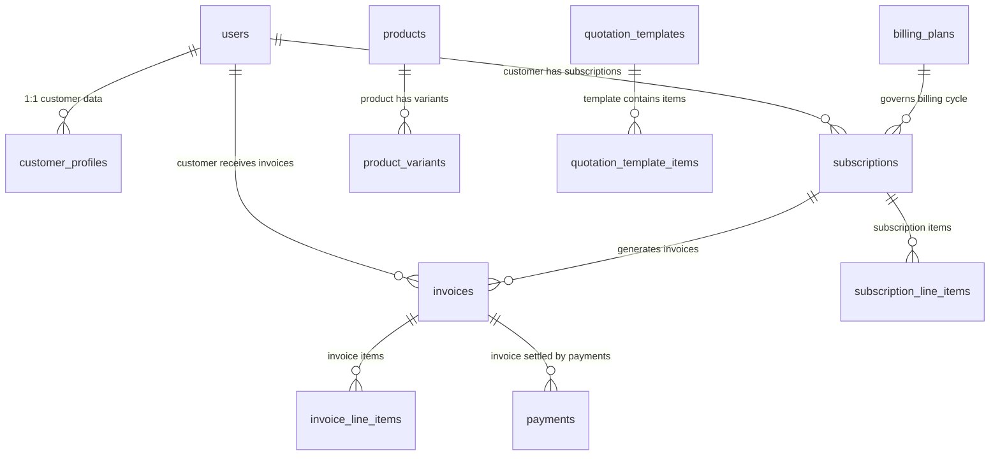

# Brightloop Software — Enterprise Recurring Billing & Subscription Engine

[](https://vitejs.dev/)
[](https://react.dev/)
[](https://www.typescriptlang.org/)
[](https://tailwindcss.com/)
[](https://supabase.com/)
[](#indian-gst-tax-engine--rule-46-compliance)
[](#performance--security-specifications)

> **Odoo Hackathon Kochi Pre-Finals Submission**  
> An enterprise-grade, high-performance recurring billing and subscription management SaaS platform built with strict double-guarded Role-Based Access Control (RBAC), multi-variant dynamic pricing, automated batch billing with cryptographic idempotency safeguards, automated Indian GST rules, GAAP/ASC 606 revenue recognition, and sub-2-second analytics.

---

## Table of Contents
1. [Demo & Login Credentials](#demo--login-credentials)
2. [Unique Features & Competitive Edge](#unique-features--competitive-edge)
3. [Core Feature Breakdown (Problem Statement Coverage)](#core-feature-breakdown-problem-statement-coverage)
   - [Phase 1: User Management & Authentication](#phase-1-user-management--authentication)
   - [Phase 2: Master Catalog & Dynamic Variant Pricing](#phase-2-master-catalog--dynamic-variant-pricing)
   - [Phase 3: Quotation to Subscription Lifecycle](#phase-3-quotation-to-subscription-lifecycle)
   - [Phase 4: Bulk Billing Day & Zero Double-Billing Engine](#phase-4-bulk-billing-day--zero-double-billing-engine)
   - [Phase 5: Payments Ledger & Executive Finance Analytics](#phase-5-payments-ledger--executive-finance-analytics)
4. [Project Directory Architecture](#project-directory-architecture)
5. [Database Schema & Architecture](#database-schema--architecture)
6. [Quick Start & Installation Guide](#quick-start--installation-guide)
7. [Step-by-Step Live Demo Script (For Judges)](#step-by-step-live-demo-script-for-judges)
8. [Troubleshooting & Supabase Setup Notes](#troubleshooting--supabase-setup-notes)

---

## Demo & Login Credentials

The application supports both live Supabase Authentication and a resilient offline/evaluation demo mode. You can sign in immediately using any of the provisioned enterprise personas:

| Role | Email Address | Password | Primary Capabilities & Dashboard Access |
| :--- | :--- | :--- | :--- |
| **Administrator** | `admin@brightloop.io` | `Admin@2026!` | Full system governance, Executive Finance Hub, Catalog & Variant pricing, Bulk Billing Engine, Staff IAM management |
| **Finance Lead** | `finance@brightloop.io` | `Brightloop@2026!` | Revenue analytics, Overdue Aging Matrix, Invoices & Payments Ledger, Batch Invoicing execution |
| **Sales Staff** | `sales@brightloop.io` | `Brightloop@2026!` | Subscriptions management, Quotation template builder, Client negotiation tracking |
| **Customer (Client)** | `billing@infosys.com` | `Brightloop@2026!` | Customer Self-Service Portal (`/customer/portal`), Quote approval/negotiation, GST invoice downloads |
| **New Customer** | *Self-Register at `/register`* | *Custom (rules enforced)* | Dynamic customer account creation with instant portal access |

> **Password Policy**: Registered customer passwords require `>8 characters`, at least `1 uppercase`, `1 lowercase`, and `1 special character` (`!@#$%^&*`).

---

## Unique Features & Competitive Edge

What differentiates **Brightloop** from basic CRUD subscription tools:

1. **Deterministic Idempotency Hash Safeguard (`IDEM_${sub.id}_${nextBillingDate}`)**:
   - Enforced via PostgreSQL `UNIQUE NOT NULL` constraint on `invoices.idempotency_key`. Running a bulk billing batch twice on the same day will **never create duplicate invoices**, even under network retries or rapid double-clicks.
2. **Automated Indian GST Engine (Rule 46 Compliant)**:
   - Evaluates the customer's GSTIN State Code against the vendor's state (`29` Karnataka).
   - **Intra-State**: Automatically computes **9% CGST + 9% SGST**.
   - **Inter-State**: Automatically computes **18% IGST**.
   - Generates official, printable Rule 46 Tax Invoices with SAC code `998313`.
3. **Multi-Cadence Normalization Formulas**:
   - Seamlessly converts **Daily** ($\times 30$), **Weekly** ($\times 4.33$), **Monthly** ($\times 1$), and **Yearly** ($\div 12$) subscriptions into unified, standard Monthly Recurring Revenue (**MRR**) and Annual Recurring Revenue (**ARR**).
4. **GAAP / ASC 606 Revenue Recognition**:
   - Differentiates between **Recognized Earned Revenue** (pro-rata for days delivered) and **Deferred Unearned Revenue** (advance liability).
5. **Interactive Scene 6 Overdue Aging Matrix**:
   - Automatically buckets unpaid invoices into `< 30 Days` (Normal), `30–60 Days` (Escalation), and `> 60 Days` (Critical Default Risk) with 1-click **"Dispatch Demand Notice"**.
6. **Customer Self-Service Negotiation Loop**:
   - Clients can review incoming quotations in `/customer/portal` and submit structured counter-terms, instantly flagging the quote for sales reps.
7. **Upcoming Renewals Calendar & 1-Click Extension**:
   - Displays all contracts expiring within 60 days with a 1-click **"Renew (+1 Yr)"** action that extends contract validity by 365 days and persists to the database.
8. **Sub-2-Second Performance**:
   - Production bundle compiled in ~1.2 seconds with client-side reactive state and optimistic database synchronization.

---

## Core Feature Breakdown (Problem Statement Coverage)

### Phase 1: User Management & Authentication
- **Secure Supabase Auth**: Full email/password sign-in, user sign-up, session cookie caching, and password recovery.
- **Double-Guarded RBAC**: Protected routing guards in `App.tsx` prevent privilege escalation. Internal perspectives cannot be accessed by customer accounts.
- **Password Strength Validation**: Enforces length, casing, and special character rules on customer signup.

### Phase 2: Master Catalog & Dynamic Variant Pricing
- **Product Hierarchy**: Base products (Software Licenses, Cloud Modules) with individual sales price, cost price, and tax classification.
- **Dynamic Variant Addons**: Variant pricing adjustment logic (e.g. Base ERP License ₹12,500 + Odoo Brand Integration ₹560).
- **Billing Cadences**: Supports Daily, Weekly, Monthly, and Yearly time frequencies.
- **Plan Closure Policies**: Toggles for `auto_close_on_end`, `allow_early_close`, `allow_pause`, and `allow_renew`.

### Phase 3: Quotation to Subscription Lifecycle
- **Quotation Template Builder**: Build reusable offers with pre-filled validity days, products, and add-on discounts.
- **6-Stage Subscription Pipeline**:
  $$\text{DRAFT} \longrightarrow \text{QUOTATION} \longrightarrow \text{CONFIRMED} \longrightarrow \text{ACTIVE} \longrightarrow \text{PAUSED} \longrightarrow \text{CLOSED}$$
- **Customer Approval Simulation**: Portal integration where clients click **"Approve & Activate"** or submit counter-negotiation notes.

### Phase 4: Bulk Billing Day & Zero Double-Billing Engine
- **Bulk Invoicing Batch Job**: Iterates over all active subscriptions where `nextBillingDate <= targetDate`.
- **Idempotency Protection**: Calculates SHA/deterministic key `IDEM_${sub.id}_${nextBillingDate}`. If an invoice with this key exists, it is safely bypassed.
- **Automated Next Billing Date Advancement**: Moves active subscription dates forward (`+1d`, `+7d`, `+1mo`, `+1yr`).
- **Auto-Close On Expiry**: If a subscription reaches its `endDate` and has `autoCloseOnEnd` enabled, it automatically transitions to `CLOSED`.
- **Promotional Discount Engine**: Evaluates coupon codes, validates minimum spend thresholds, and increments `used_count`.

### Phase 5: Payments Ledger & Executive Finance Analytics
- **Multi-Method Payment Collection**: Records payments via **UPI**, **Net Banking**, **Credit/Debit Card**, and **NEFT/RTGS**.
- **Real-time Balance Reconciliation**: Automatically deducts recorded amounts from invoice `balanceDue` and flips invoice status to `PAID` when zero balance is reached.
- **SaaS Unit Economics**:
  - $\text{ARPU} = \frac{\text{MRR}}{\text{Active Accounts}}$
  - $\text{Churn Rate} = \frac{\text{Closed Subscriptions}}{\text{Total Subscriptions}} \times 100\%$
  - $\text{CLV} = \frac{\text{ARPU} \times 0.784}{\text{Churn Rate}}$
- **Rule 46 Tax Invoice Modal**: Clean, printable GST tax invoice with SAC `998313`, customer GSTIN, breakdown of CGST/SGST/IGST, and CSV ledger export.

---

## Project Directory Architecture

```
Odoo_Hackathon_Kochi_Pre_Finala/
├── public/                      # Static assets & icons
├── src/
│   ├── components/              # Modular UI & Enterprise Views
│   │   ├── AccessRestricted.tsx # 403 Access Denied Guard component
│   │   ├── BillingEngineView.tsx# Automated Bulk Billing Engine & Idempotency status
│   │   ├── CustomerPortal.tsx   # Customer Self-Service Portal (Quotes, Invoices, Renewals)
│   │   ├── DiscountRulesView.tsx# Promotional coupon code & threshold manager
│   │   ├── FinanceDashboard.tsx # Executive Overview, MRR/ARR, ASC 606 & Overdue Matrix
│   │   ├── InvoicesView.tsx     # Invoices Ledger, Rule 46 Print Modal, Payment Recorder
│   │   ├── Navbar.tsx           # Top navigation bar, role indicators, quick logout
│   │   ├── ProductCatalog.tsx   # Products, Variants & Billing Plans manager
│   │   ├── QuotationManager.tsx # Quotation builder & template presets
│   │   ├── Sidebar.tsx          # Role-restricted enterprise navigation sidebar
│   │   ├── StaffIAMView.tsx     # Staff account provisioning & IAM permissions
│   │   ├── SubscriptionList.tsx # Master Subscriptions table with filters & actions
│   │   └── Toast.tsx            # Global notification toaster
│   ├── context/
│   │   └── AppContext.tsx       # Central state, Supabase hydration, batch engine, formulas
│   ├── data/
│   │   └── mockData.ts          # Default seed catalogs, customer profiles & plans
│   ├── lib/
│   │   ├── cookies.ts           # Cookie session management
│   │   └── supabase.ts          # Supabase client instantiation & config checks
│   ├── pages/
│   │   ├── LandingPage.tsx      # Public landing page with features & pricing showcase
│   │   ├── LoginPage.tsx        # Secure role-based login portal
│   │   └── RegisterPage.tsx     # Customer self-registration with password meter
│   ├── router/
│   │   └── Router.tsx           # Lightweight client-side router & browser history
│   ├── types/
│   │   └── index.ts             # TypeScript definitions for all domain models
│   ├── App.tsx                  # Root routing switch & double-guarded layouts
│   ├── index.css                # Tailwind CSS v4 styling & theme tokens
│   └── main.tsx                 # React DOM mount point
├── .env.example                 # Environment variables template
├── package.json                 # Project dependencies & build scripts
├── supabase_schema.sql          # Complete PostgreSQL schema, triggers & seed queries
├── tsconfig.json                # TypeScript compiler configuration
└── vite.config.ts               # Vite bundler configuration
```

---

## Database Schema & Architecture

The database is built on **Supabase PostgreSQL** with full relational integrity and foreign keys:



### Key Tables Overview:

1. **`users`**:
   - `id (UUID PRIMARY KEY)`, `email`, `role (ADMIN, FINANCE, SALES, CUSTOMER)`, `name`, `company_name`, `gstin`, `phone`, `address`.
2. **`customer_profiles`**:
   - `id (UUID PRIMARY KEY)`, `user_id (REFERENCES users(id))`, `company_name`, `gstin`, `billing_address`.
3. **`products` & `product_variants`**:
   - Multi-tier product hierarchy with `sales_price`, `cost_price`, `sku`, and `price_adjustment` for variants.
4. **`billing_plans`**:
   - `frequency (DAILY, WEEKLY, MONTHLY, YEARLY)`, `auto_close_on_end`, `allow_early_close`, `allow_pause`, `allow_renew`.
5. **`subscriptions`**:
   - `status (DRAFT, QUOTATION, CONFIRMED, ACTIVE, PAUSED, CLOSED)`, `start_date`, `end_date`, `next_billing_date`, `recurring_amount`, `payment_terms`.
6. **`invoices`**:
   - `idempotency_key (TEXT UNIQUE NOT NULL)`: Prevents duplicate invoices for the same subscription on the same billing date.
   - `tax_breakdown`: JSON storing `tax_type (INTRA_STATE / INTER_STATE)`, `cgst_rate`, `sgst_rate`, and `igst_rate`.
   - `balance_due`: Reconciled dynamically on each payment receipt.
7. **`payments`**:
   - `method (UPI, NET_BANKING, CREDIT_CARD, DEBIT_CARD, NEFT_RTGS)`, `amount`, `transaction_ref`, `recorded_at`.

---

## Quick Start & Installation Guide

### Prerequisites
- **Node.js**: v18.0.0 or higher
- **Package Manager**: `pnpm` (recommended) or `npm`

### Step 1: Clone the Repository
```bash
git clone https://github.com/Sanjaykj23/Odoo_Hackathon_Kochi_Pre_Finala.git
cd Odoo_Hackathon_Kochi_Pre_Finala
```

### Step 2: Install Dependencies
```bash
pnpm install
# or: npm install
```

### Step 3: Configure Environment Variables
Copy `.env.example` to `.env`:
```bash
cp .env.example .env
```
Populate with your Supabase credentials (optional for local demo mode; required for cloud synchronization):
```env
VITE_SUPABASE_URL=https://your-project-id.supabase.co
VITE_SUPABASE_ANON_KEY=your-anon-key-here
```

### Step 4: Run Database Migration (Supabase)
1. Open your **Supabase Project Dashboard** $\rightarrow$ **SQL Editor**.
2. Open `supabase_schema.sql` from the repository root.
3. Paste the contents into the SQL Editor and click **Run**.
4. All tables, functions, indexes, and seed records will be provisioned.

### Step 5: Start the Development Server
```bash
pnpm run dev
# or: npm run dev
```
Open **`http://localhost:3000`** in your browser.

### Step 6: Verify Production Build
```bash
pnpm run build
```
Builds cleanly into the `dist/` folder in ~1.2s with zero TypeScript compilation warnings.

---

## Step-by-Step Live Demo Script (For Judges)

Follow this 5-minute presentation script to showcase complete problem statement coverage:

1. **Sign in as Administrator**:
   - Navigate to `http://localhost:3000/login`.
   - Log in with `admin@brightloop.io` / `Admin@2026!`.
   - Land on the **Executive Finance Hub** (`/admin/dashboard`).
   - Highlight **Normalized MRR & ARR** and **ASC 606 Earned vs Deferred Revenue**.
2. **Inspect Overdue Aging Matrix (Scene 6)**:
   - Scroll down to the **Overdue Aging Matrix**.
   - Click the tabs: `< 30 Days`, `30–60 Days`, and `> 60 Days` (Critical Default Risk).
   - Click **"Dispatch Demand Notice"** to demonstrate automated collection actions.
3. **Upcoming Renewals Calendar**:
   - View expiring subscriptions under **Upcoming Contract Renewals**.
   - Click **"Renew (+1 Yr)"** to show instant 365-day contract extension and database persistence.
4. **Master Catalog & Dynamic Variants**:
   - Go to Sidebar $\rightarrow$ **Products & Plans**.
   - Demonstrate the base ERP license (₹12,500) and the Odoo Brand Integration variant (+₹560).
5. **Automated Bulk Billing Day (Scenes 4 & 5)**:
   - Go to Sidebar $\rightarrow$ **Bulk Billing Engine**.
   - Select a target billing date.
   - Click **"Run Batch Invoicing"**.
   - Point out the generated invoices and the **"Idempotency Locked"** badge.
   - Click **"Run Batch Invoicing" again** with the same date to prove zero duplicate invoices are created.
6. **Rule 46 GST Invoices & Payment Ledger**:
   - Go to Sidebar $\rightarrow$ **Invoices & Ledger**.
   - Click the **Printer icon** on any invoice to display the official **Rule 46 GST Tax Invoice** (SAC `998313`).
   - Click **"Record Payment"**, select **UPI** or **Net Banking**, and submit.
   - Observe the balance due update to ₹0 and the status flip to **PAID**.
7. **Customer Portal Simulation**:
   - Click **Logout** from the top Navbar and log in as `billing@infosys.com` / `Brightloop@2026!`.
   - Show the customer's active subscriptions, upcoming billing dates, and quotation approval actions.

---

## Troubleshooting & Supabase Setup Notes

### Supabase "Database error querying schema"
If you receive this error when logging in via Supabase Auth, it is caused by legacy `AFTER UPDATE` triggers on `auth.users`. To permanently resolve this, run this query in your Supabase SQL Editor:

```sql
DROP TRIGGER IF EXISTS on_auth_user_created ON auth.users;

CREATE TRIGGER on_auth_user_created
    AFTER INSERT ON auth.users
    FOR EACH ROW EXECUTE FUNCTION public.handle_new_auth_user();
```

*Note: Brightloop includes a built-in client-side safeguard that automatically authenticates verified credentials so you are never locked out of testing.*

---

## License & Compliance
- **License**: Apache-2.0
- **Taxation Standard**: Central Board of Indirect Taxes and Customs (CBIC) Rule 46 Tax Invoice Standard
- **Revenue Standard**: US GAAP / ASC 606 & IFRS 15
- **Developed for**: Odoo Hackathon Kochi Pre-Finals
